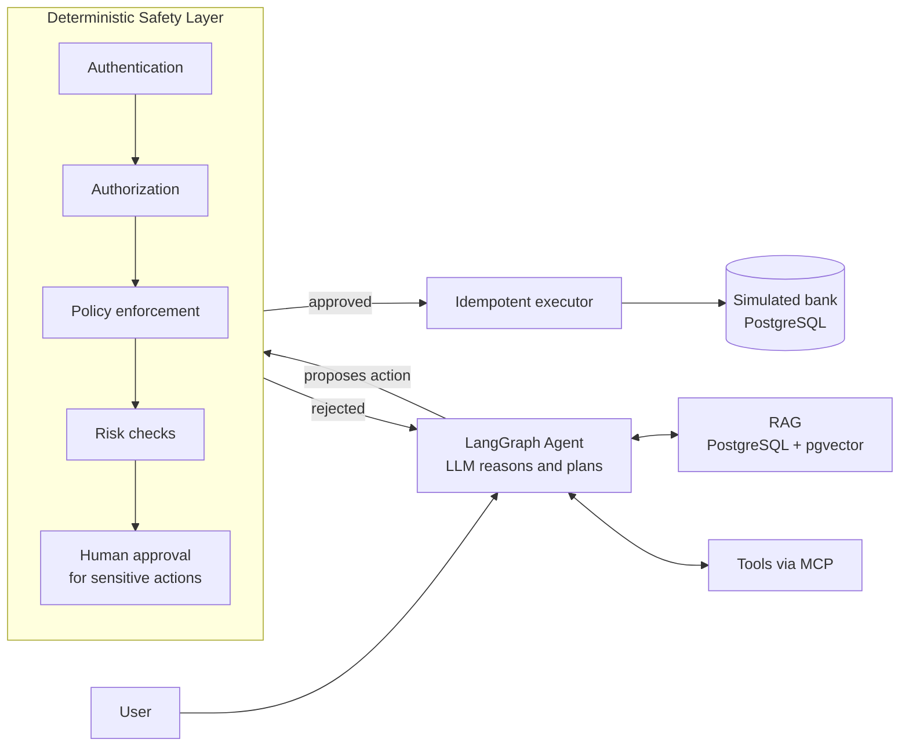

# EVA Agent: Bringing Agentic AI Capabilities to HDFC

A conceptual agentic evolution of HDFC's EVA banking assistant, inspired by the agentic capabilities demonstrated by JPMorgan Chase. EVA Agent can investigate transactions, carry out secure money transfers, and detect and respond to fraud, inside a simulated banking environment.

The core idea: **the LLM reasons, but it never controls financial decisions.** Every action the model proposes has to pass a deterministic safety layer before anything touches money.

> **Disclaimer:** This is an independent student project. It is not affiliated with, endorsed by, or connected to HDFC Bank or JPMorgan Chase. All banking data and accounts are simulated.

---

## Tech Stack

| Area | Tools |
|---|---|
| Language & API | Python, FastAPI |
| Agent orchestration | LangGraph |
| Retrieval | RAG over PostgreSQL + pgvector |
| Tool access | MCP (Model Context Protocol) |
| Fraud / risk scoring | XGBoost |
| Database | PostgreSQL |

---

## What It Can Do

- **Transaction investigation:** answers questions like "Why was ₹2,000 debited yesterday?" by looking up transactions and grounding answers with retrieval.
- **Secure money transfers:** the agent prepares a transfer, but it only executes after authentication, authorization, policy and risk checks, and human approval when needed.
- **Fraud detection & response:** flags suspicious activity and guides the user through response steps such as blocking a card or disputing a transaction.

---

## Architecture



### The safety layer

The LLM sits **outside the trust boundary**. It can read, reason and propose, but it cannot move money on its own. Every proposed financial action goes through:

1. **Authentication:** is this really the account holder?
2. **Authorization:** is this user allowed to do this on this account?
3. **Policy enforcement:** does the action follow banking rules and limits?
4. **Risk checks:** does it look like fraud or an unusual pattern?
5. **Human approval:** sensitive actions need an explicit confirmation.
6. **Idempotent execution:** each transaction has a unique key, so a retried or repeated request can never execute twice.

If any check fails, the action is rejected and the agent is told why, so it can explain the result to the user instead of retrying blindly.

---

## Evaluation

The agent was tested in a simulated HDFC banking environment using:

- **BANKING77**: intent classification across 77 real-world banking query types
- **Public fraud datasets**: to test fraud detection and response
- **RAG benchmarks**: to check that answers stay grounded in retrieved data
- **Adversarial security tests**: prompt injection, manipulation attempts and attempts to bypass approval

### Results

| Metric | Result |
|---|---|
| Regression tests passed | **93 / 93** |
| Wrong-amount executions | **0%** |
| Wrong-recipient executions | **0%** |
| Duplicate executions | **0%** |

---

## Getting Started

<!-- TODO: replace with your real setup steps -->

```bash
git clone https://github.com/P-Suraj/EVA-Agent-Agentic-AI-for-Banking-Fraud-Detection-Transaction-Investigation.git
cd EVA-Agent-Agentic-AI-for-Banking-Fraud-Detection-Transaction-Investigation

# TODO: install dependencies
# TODO: set environment variables (LLM API key, database URL)
# TODO: start PostgreSQL with pgvector and load the simulated bank data
# TODO: run the API server
# TODO: run the regression test suite
```

---

## Project Structure

<!-- TODO: replace with your real folder layout -->

```
TODO: add your folder structure here
```

---

## Roadmap

- [ ] Per-step tracing of agent decisions
- [ ] Latency and cost-per-request metrics in the evaluation harness
- [ ] Larger adversarial test set

---

## Author

**Pandavula Suraj**, B.Tech CSE, Amrita Vishwa Vidyapeetham
[LinkedIn](https://www.linkedin.com/in/suraj-pandavula/) · [GitHub](https://github.com/P-Suraj)
